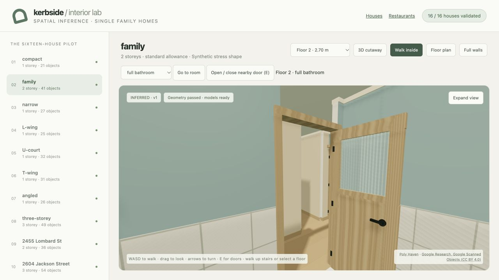
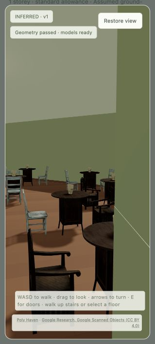
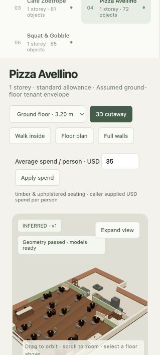

# Interior space use and coordinated finishes

The local [house tour](http://127.0.0.1:8794/inferred-interiors/) now regenerates all sixteen
pilot houses with destination-based hallway pruning, compact fully furnished wet rooms,
coordinated room paint and detailed timber/glazed doors. The
[restaurant tour](http://127.0.0.1:8794/inferred-restaurants/) applies the same usable-space
principle to connected clear floor after equipment, seated envelopes and walking clearances.

## Space changes

The same eight synthetic and eight mapped house inputs remain in the pilot. No house was
removed or replaced to obtain a passing batch. Each house compares three physically valid
partitions when available, ranking actual circulation share and oversized room area.

- All **16/16** pass independent spatial checks, with **657 placed objects**.
- The pruning pass returns **101.85 m²** of circulation to rooms. Total hallway area in the
  final selected layouts is **563.28 m²**, versus **655.35 m²** before this revision: a net
  **92.07 m² / 14.0% reduction**. The difference reflects selection of different partitions.
- A separate end-cap check finds no unsupported full-width corridor branches extending
  beyond all room entrances. Short doorway approaches and turns remain usable circulation.
- Wet-room area falls from **578.60 m²** to **193.31 m²**. Full bathrooms are at most
  **8.16 m²** and have a toilet, basin and 1.45–1.70m tub/shower. WC-only rooms are at most
  **4.02 m²** and have both fixtures. Surplus goes to adjoining rooms, furnished studies or
  sitting rooms, or usable fitted storage.
- The narrow single-storey fixture gains a **4.02 m² separate WC** while retaining its
  **6.86 m² tub bathroom**. A second WC is proposed only if physical furnishing and access
  checks pass. Laundry and closets also require functional objects.

Door placement is checked against the actual room connection set, including closet and
study access. Rotated shared-edge overlays use a 0.1 micrometre arithmetic grid; independent
coverage, overlap, doorway and navigation checks still gate acceptance. This is a bounded
layout heuristic, not proof of a globally optimal floor plan or an as-built reconstruction.

## Finishes and facade

Room paint varies within four stable house palettes. The renderer now carries each room's
colour onto its exterior-wall lining instead of overriding it with white. Skirting, cornices,
tiled wet-room wainscot and warm ceiling lights add variation. Doors have wood grain, jambs,
recessed panels, hinges, metal handles and purpose-specific glass: reeded privacy panes for
bathrooms and clear glazing for offices/entries. Tub fixtures have an open basin, rim, drain,
plumbing and transparent shower screen instead of a sealed tall box.

Kerbside remains the source of mapped window cuts and balcony geometry. The canonical
facade exporter and its saved envelopes are unchanged. Parity tests cover mapped openings,
terrain-relative floor elevations and both procedural and photo-derived balcony cases.
Static responses and generated-data fetches now avoid stale browser caching. Keyboard taps
also turn the tour by a visible increment; held keys still provide smooth movement.

## Restaurant retest

Rounds 8–10 retained each failure and replaced every successful venue with a new venue.
The history now contains **37 distinct mapped tenant hypotheses**, all passing in at least
one round. The latest cohort is **5/5**:

| Test venue | Seats | Service |
| --- | ---: | --- |
| Scoma's Restaurant | 0 | pickup |
| Grandeho’s Kamekyo | 14 | table |
| Cafe Zoetrope | 26 | table |
| Pizza Avellino | 31 | table |
| Squat & Gobble | 31 | table |

All five latest layouts have **0.0 m²** of isolated clear-floor pockets under the audit's
0.5m² reporting threshold. Pickup layouts now test deeper kitchen bands, alternate station
packing orders and compact equipment before rejecting a small footprint. No required station
or clearance was removed to fit Scoma's 30.2m² mapped test envelope. That envelope is an
unverified ground-floor tenant assumption, not evidence of the real restaurant layout.

The browser's Apply spend flow was tested at USD 35 for Pizza Avellino: it regenerated a
standard furnishing tier, used caller-supplied economic provenance and passed geometry.
The temporary override was removed afterward. Published cohort prices remain clearly
illustrative; production uses the caller's USD spend.

## Verification

**98 focused tests passed**. Ruff, JavaScript syntax and Git whitespace checks passed.

The focused suite covers serialized room inventory and access, corridor reclamation and
area conservation, different coordinated paints and door designs, outer-wall finish
selection, canonical window/balcony parity, every occupied-room spawn, all 17 stair
connections walked up and down, restaurant inventory and seating corruption, isolated-floor
pockets, unseen shapes and rotating-cohort history. Browser checks cover eye-level rooms,
timber/reeded doors, room selection, turning, expanded view, restaurant dining and spend
regeneration. Browser console checks had no errors. The live-map overlay's previously
reported disposed-terrain lifecycle limitation remains outside this standalone tour revision.

