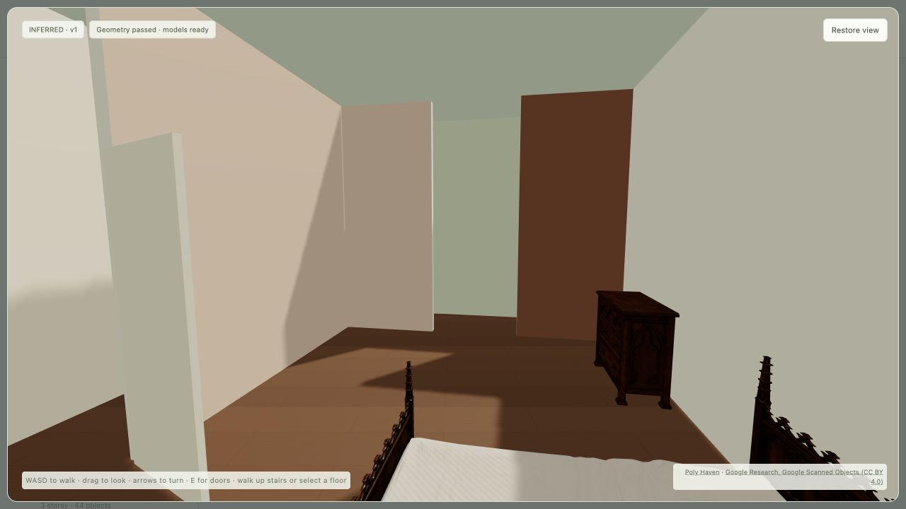
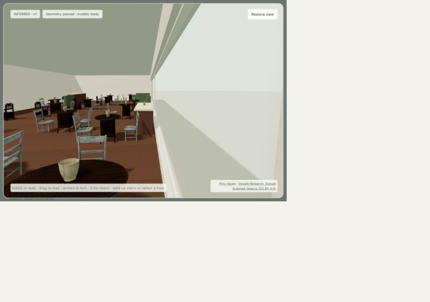

# Interior tours and restaurant pilot — 2026-10-21

Implemented in the `codex/interior-engine` worktree. Nothing was deployed externally.

- [House tours](http://127.0.0.1:8794/inferred-interiors/): canonical Kerbside window and balcony
  positions, consistent terrain-relative storeys, actual holes/glazing, private doors,
  ceilings and collision-aware eye-level walking. Sixteen houses pass, with 577 objects.
- [Restaurant tours](http://127.0.0.1:8794/inferred-restaurants/): kitchen/WC/service partition,
  connected seating approaches, occupied-chair clearances, optional booths/bar, professional
  equipment, coherent finishes and spend-driven furniture regeneration through the local API.
- 86 local licensed assets, including eight additional hospitality assets. Procedural fixtures
  cover missing commercial equipment and booths. Source and file hashes remain in the asset
  manifest; every generated spatial element carries uncertainty fields.

Seven restaurant rounds selected five unique venues before each run. Failures stayed in the
next round and all prior successes were excluded. Twenty-five distinct mapped venue
hypotheses were tried; twenty-four passed in at least one round. The latest round is **4/5**:
Nob Hill Cafe, Cafe Tiramisu, Hotpot Champ and Mayes Oyster House passed. The **30.2 m² mapped
Scoma's envelope** remains rejected because no reachable service counter fits with the
required program. This is an unverified tenant envelope, not a conclusion about the real
restaurant. It is retained automatically for the next run.

Testing found and fixed rotated-cut residual geometry, mismatched stair approach sides
between storeys, and an exact-boundary crack between rotated treads. No per-venue rules or
relaxed clearance exception was added. An optional bar can be explicitly omitted if it
prevents the required program; an explicitly requested bar service mode remains strict.

Validation: **93 focused tests passed**. These include all 17 stair connections walked up and
down, every occupied house room having a clear spawn point, facade/balcony parity probes,
asset hashes, kitchen/seat/prop corruption tests, unseen rotated/bar and compact pickup
cases, and cohort replacement/history immutability. Ruff, JS syntax and Git whitespace
checks pass. The browser loaded models without errors, walked via keyboard, visited an
upstairs bedroom, rendered restaurant dining/kitchen/bar areas, and regenerated furnishings
from a test USD spend. The temporary price override was removed afterward; the viewer opens
the labeled illustrative batch prices. A final AST-only Graphify update was run.

The independent local tour is verified. The opt-in live map overlay still inherits the
pre-existing overview/region disposed-terrain lifecycle limitation recorded in the initial
pilot; no full live-map walking pass is claimed. Interior and tenant layouts remain inferred,
not as-built measurements. Input bounds and exhaust/accessibility limitations are described
in [the restaurant design notes](../26-restaurant-inference.md).

