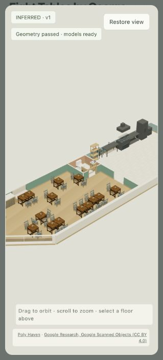
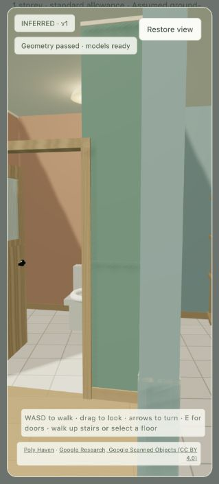
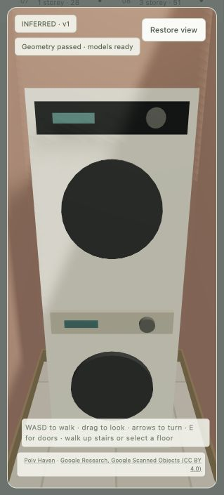

# Modular restaurant dining and fitted hall laundry

Restaurant groups now seat **2, 4 or 6 people**. A two-person rectangular table is a single
module; four- and six-person groups join two or three modules with aligned chairs and one
shared clear approach. Capacity is counted from chairs and bench places. Larger party sizes
are tried before spare capacity fills with smaller groups. Joined modules, seated pull-back
envelopes, service queues and connected 0.95m customer routes are independently checked.

Every dining chair in a restaurant uses one stable design. Booths use one stable channel,
tufted or timber-backed family per restaurant; lengths vary with their party size. Designs
vary between restaurants according to their stable seed and USD spend tier. Bar stools also
use a stable design. Round tabletop assets are excluded from joined rectangular groups.

Booths are generated in the footprint's own orientation. Their **entire back** must follow a
solid wall, with a small fitting gap. Open room transitions, doors and the glazed entrance
frontage are excluded. Rotating a booth away from its backing fails independent validation.
Restaurant wall ends and tiled sections now carry the room's wall hue, including behind
kitchen equipment; the previous fixed-white cap material no longer leaves vertical patches.

All sixteen house inputs are retained. **Eight former hall ends** now contain a fitted
washer with a dryer physically supported on top. Each niche is about **2.02m²**, with a clear
front approach. The complete 1.75m stack is checked against windows before insertion. Both
boxes back onto the wall, share the same footprint and meet exactly at the support elevation.
No niche is inserted when it would take away a door or stair approach. Other unsupported
corridor tails continue to be incorporated into rooms. The tour's laundry view stands on
the clear approach so both appliances can be seen.

## Retest

The next restaurant cohort replaced all five previous successes, preserving the rotation
protocol. The new round is **5/5**:

| Venue hypothesis | 2-person | 4-person | 6-person | Total seats | Booth groups |
| --- | ---: | ---: | ---: | ---: | ---: |
| S F Hospitality Inc | 0 | 0 | 0 | 0, pickup | 0 |
| Bow Hon Seafood Restaurant | 3 | 1 | 1 | 16 | 0 |
| Eight Tables by George Chen | 6 | 4 | 1 | 34 | 2 |
| North Beach Restaurant | 13 | 11 | 1 | 76 | 2 |
| Today Food | 1 | 2 | 1 | 16 | 2 |

All four seated venues contain every party size; all five report no isolated clear-floor
pockets of at least 0.5m². Test spend values and full-building tenant assumptions remain
explicitly illustrative, not claims about these real venues.

**16/16 houses pass. 140 focused tests pass:** 127 engine, tour, facade, headset and street
checks, plus 13 app/cache/generated-renderer checks. Tests include a previously unseen rotated
restaurant, whole-back booth contact, corrupted module capacities and chair families, stable
cross-venue design variation, wall finish selection and supported laundry stack corruption.
All occupied room spawns and all 17 stair connections remain traversable. Ruff, JavaScript
syntax and whitespace checks pass. Browser review confirms joined tables, kitchen wall
colour, room selection and the laundry stack without console errors.

## Repository integration

The complete interior inference history is integrated with the current Kerbside source in
`spatial-mapping-crowdsource`. It preserves the latest headset, window and street changes.
All app/headset pages were regenerated from the merged authoritative renderer and their
release hashes/cache version rebuilt. The generated house map layer remains opt-in via
`?inferredInteriors=1`; the standalone local tours remain the reviewed interface. No remote
push or deployment is part of this commit request.

