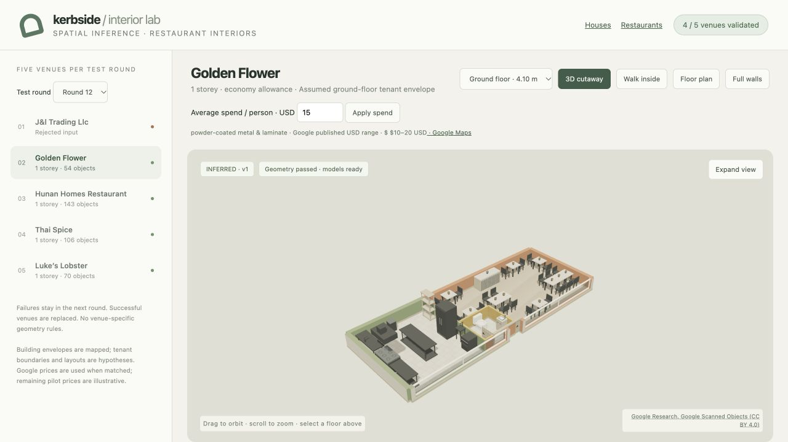
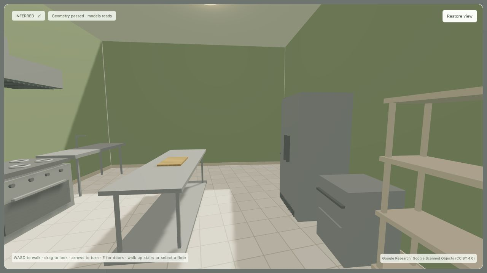

# Restaurant price ingestion, shell dimensions and professional prep

Implemented on `claude-region-parity`, 2026-10-22.

- Google Places price ingestion: bounded official API queries, offline imports, existing enrichment reuse,
  unique business identity and distance checks, expiring local cache, actual USD range preference,
  configurable inferred level bands and explicit caller-spend priority. Ordinary Nearby requests
  retain their existing field mask. See [operator instructions](../26-restaurant-inference.md#google-price-ingestion-and-kerbside-dimensions-2026-10-22).
- Live acquisition exercised ten bounded Text Search requests while developing the name matching.
  Two of the five selected venues yielded usable price evidence: Golden Flower, $10–20 (budget $15),
  and Thai Spice, $20–30 (budget $25). Three remain unmatched/unpriced. Unrelated nearby businesses
  are rejected. Further ingestion makes no network requests unless an explicit request budget is set.
- Restaurant footprint, entrance and floor height now come directly from Kerbside's published building
  and canonical fit. Area is calculated from the polygon, in m² and ft². Shape hash and source metadata
  accompany it. A building envelope still does not establish the actual restaurant lease boundary.
- House records now include calculated footprint/floor areas, canonical heights and source metadata.
  All 16 pilot houses pass the physical/geometry checks; eight mapped cases were regenerated and
  synthetic layouts reused. The 908-entry production house catalogue remains intact. A regression
  check now prevents a small review batch replacing the regional catalogue.
- Kitchens gain a central 1.6–2.4 × 0.8 m stainless prep table where a full 0.95 m aisle fits and both
  long-side work points remain connected to every existing station. The flat cutting board rests on
  the centre of the worktop. Visual QA corrected the initial board dimension ordering and refreshed
  the three round-13 props without changing room partitions. Steel keeps a diffuse response indoors.
- The browser can select historical test rounds and shows Google range/source links and actual
  polygon area/floor height. Interactive manual spend overrides clear the previous Google attribution;
  the endpoint retains its stored Kerbside geometry even if a caller submits another polygon.

## Rotating restaurant trials

| Round | Venue | Result | Prep island |
|---|---|---|---|
| 12 | J&l Trading Llc | Rejected: no workable kitchen band | — |
| 12 | Golden Flower | Passed | Yes |
| 12 | Hunan Homes Restaurant | Passed | Yes |
| 12 | Thai Spice | Passed | Yes |
| 12 | Luke’s Lobster | Passed | No |
| 13 | J&l Trading Llc | Same retained failure | — |
| 13 | Toy Soldier | Passed | Yes |
| 13 | Sushi on North Beach - Katsu | Passed | Yes |
| 13 | Suavecito Birria & Tacos | Passed | Yes |
| 13 | Mr. Mahjong | Passed | No |

Nine distinct venues, eight successes and one retained failure; six usable central islands.
The rejected mapped envelope is about 2.54 m wide outside, 2.24 m after wall inset: it cannot
support the required kitchen/access arrangement. Every success was replaced in round 13,
with selection fixed before inference. No address-specific layout rules were added.

## Verification

67 distinct pytest checks passed across price/geometry/prep, restaurants, houses, envelopes/tour,
space/finishes, seating/laundry, building enrichment and publishing. Modified feature Python passes
Ruff; both modified JavaScript modules parse; `git diff --check` passes. Local endpoint verification
confirmed manual price precedence and rejection of caller geometry substitution. Browser verification
confirmed the Google-fed $15 budget, source link, historical round selection and furnished kitchen tour.

