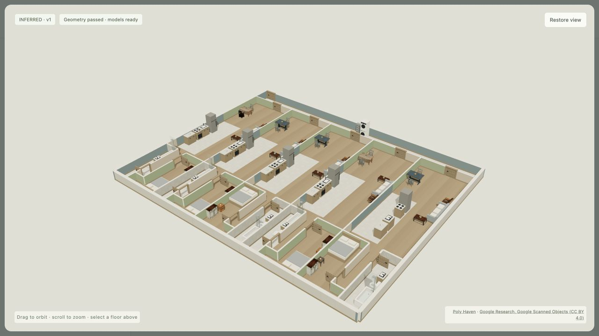
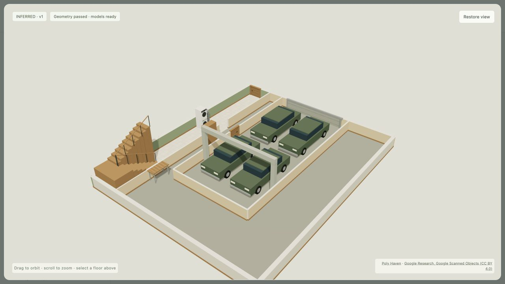

# Apartments and garages — 2026-10-27

Implemented independent 2–5-family programs, whole-floor/attached garages for 1–4 cars,
source opening extraction, common and private stairs, lower garage slab transitions,
architectural support proposals and a local tour with bounded program rebuilding.

The fixed twenty-case cohort was chosen before inference. All twelve synthetic programs
passed: 2–5 households, five homes on one floor, rotated and setback shells, 1–4 cars,
an attached lower slab, a garage/service floor and apartments with parking. Two of the eight
mapped shells passed; the six failures remain visible. Separate unseen tests cover two private
duplexes across four floors and four cars behind two recorded narrow gates.

| Mapped shell | Result |
|---|---|
| 243596363 | Rejected: garage openings on different floor elevations |
| 262552539 | Rejected: private unit furniture/program cannot fit |
| 253203887 | Rejected: source garage conflicts with common stair/entry core |
| 259928418 | Passed: three independent homes |
| 262727844 | Rejected: house/service program cannot fit around garage |
| 262727846 | Rejected: garage height conflicts with supplied storey height |
| 262096308 | Passed: existing single-family path |
| 262419190 | Rejected: recorded gates require overlapping parking envelopes |

71 distinct regression checks passed. Source extraction uses Kerbside's canonical garage
normalization and photo-opening functions; the previous facade snapshots still match exactly
without the opt-in flag. The browser rebuild control passed through the local inference API,
and the sectional door was verified in both open and closed states. Room/stair navigation
uses the same geometry as the actual tour; the map adapter shares the new slab surfaces.

The 908-house catalogue is unchanged. Existing user changes to launch/cloud-upload state
were left alone. No new asset downloads or external API requests were needed for this pass.
Objects reuse the existing library and parametric fixtures; structural objects remain inferred
proposals requiring review.

[Input contract and commands](../27-apartments-and-garages.md)

