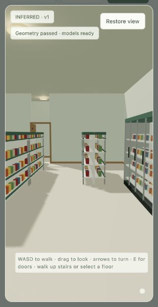
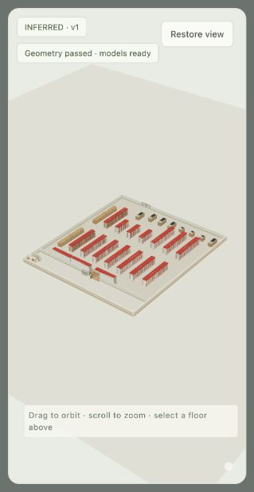
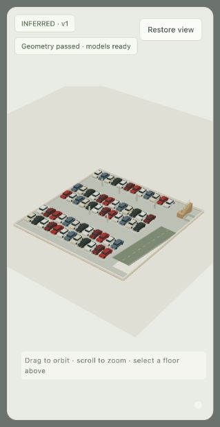
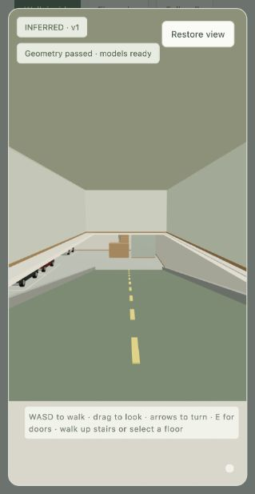

# Retail interiors — 2026-10-28

Added a grocery/corner-store inference package using real polygon cuts, stocked fixtures,
separate customer/staff programs, checkout queues, cold departments and chain-character
priors. Multi-entry stores preserve source positions/widths. The tour supports automatic
sliding doors, store rebuilding, parking-deck ramps, stairs, lift stops and source-bounded
surface parking paths. Supplied vehicle openings control ramp placement; unsourced gates
remain inferred.

The fixed 19-case cohort was selected before inference: nine synthetic programs and ten
mapped shells. All nine synthetic cases passed, including rotated/setback shapes, multiple
entries, two/three parking levels and external parking. All six mapped groceries passed.
Two of four mapped corner stores passed; 7-Eleven (256067716) and Adel's Wine Cellar
(265674114) remain rejected for entry/checkout/staff-space conflicts. No address-specific
layout exceptions were introduced.

The shared map overlay adds eight validated mapped stores and keeps all 908 prior entries
unchanged. The original places files and unrelated untracked state remain untouched.

The inventory contains 3,185 nine-county retail candidates from the existing Overture
extract, with source licences, dates, confidence and building links. It includes 1,901 broad
grocery candidates and 1,284 convenience stores. It is not a verified supermarket census.
Four source-linked parking notes are included. **The regional parking survey is incomplete:**
3,184 candidates still need parking type or level research; no current garage-level count
is asserted from a historical planning proposal. See the source links and input contract in
[the implementation notes](../28-grocery-and-corner-stores.md).

Validation covers department completeness, fixture/support bounds, door/queue clearance,
connected routes, source opening alignment, unknown parking, ramps, lift/core connections,
map publishing and a real HTTP rebuild request. Pure JavaScript probes use the actual tour
engine to visit rooms, ascend/descend ramps and stairs, transfer by lift and walk from the
surface lot through the entrance. Browser checks verify store rebuilding and lift trips
from the store to B2 and back. Structural elements are inferred proposals.

All 85 interior regression checks passed in the final combined run, including houses,
apartments, restaurants and stores. Python lint, JavaScript parsing and whitespace checks
also passed.

