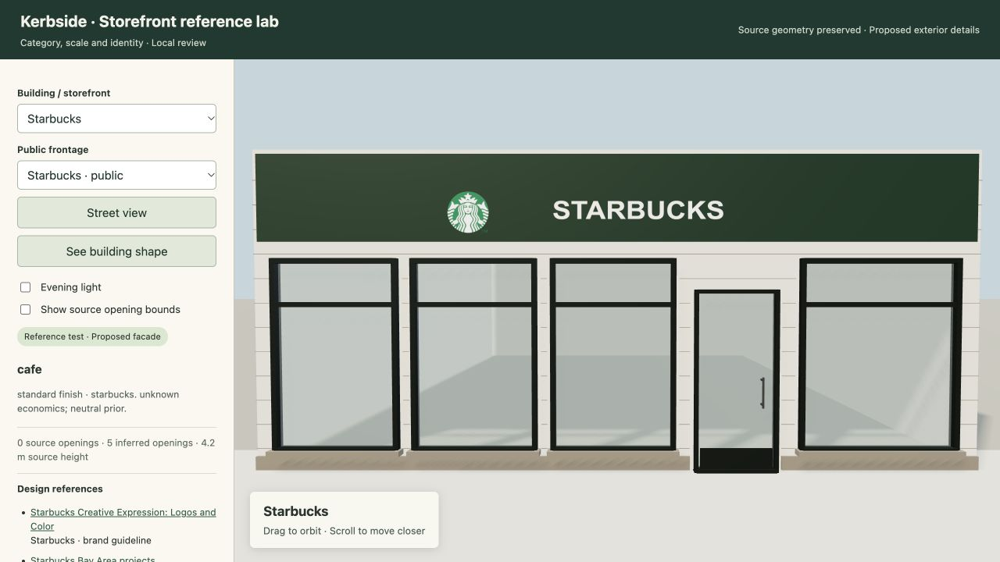
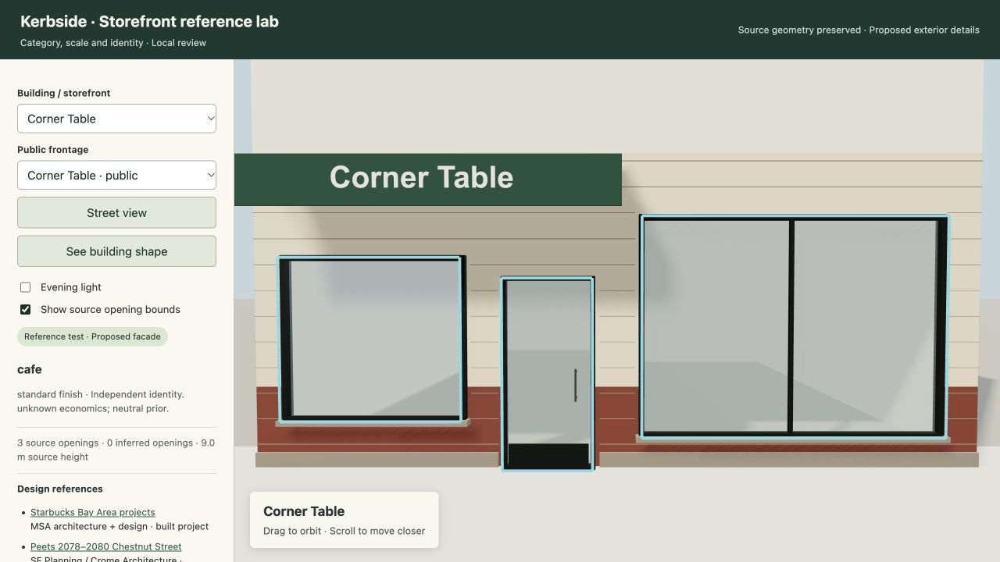

# Researched storefront exteriors — 2026-10-29

Implemented `smc.exteriors`, a deterministic exterior planner, evidence database, Three.js renderer and isolated local review builder. It fits frontages to actual Kerbside polygons and heights, including nonrectangular footprints and multiple tenants. Measured windows, doors, garages, material bands and protected balcony areas take priority over stylistic inference.

## Coverage and evidence

The [reference index](2026-10-29-storefront-reference-index.md) contains 43 sources, 25 category profiles and 13 chain families. Primary references include municipal drawings, original architects, sign fabricators, merchants and brand designers. Sources retain dates, locations and distinctions between built projects, historical proposals and prototype renderings.

Chain families: Starbucks, Starbucks Reserve, Subway, Safeway, Whole Foods Market, Trader Joe's, Peet's, Philz, 7-Eleven, Chipotle, Chase, CVS and Walgreens. Seven official artwork masters are archived with source URLs and SHA-256s. Other lettering uses labeled fallback typography.

Examples include dark cafe frames and transoms, broad diner panes, grocery glazing clustered around customer entries, solid stockroom/service walls, door lettering on skinny frontages, awning valances, fascia/lightboxes, blade signs, painted names and quiet institutional entrance identity. Finish choices vary by category, dimensions and supplied economic tier; unknown cost is explicitly unknown.

Official brand components can be exact. Whole generated facades remain inferred: neither a chain name nor a historical drawing proves a site's current appearance. Profile dimensions are engineering priors, not a measured statistical survey.

## Verification

- **306 tests passed** in 94.54 seconds across new exteriors, facade geometry/rendering, and existing house, apartment, restaurant and store inference suites.
- **68 fixed programs passed layout validation:** 48 synthetic cases covering every category/chain and difficult geometry, plus 20 frozen mapped Kerbside identities. No failed identity was replaced to improve the result.
- All 68 loaded in the real browser without reported errors, blank case identity or missing brand assets. Street/orbit, evening light and source-opening overlays were exercised.
- Real Three.js r160 geometry checks covered all 68: 66,234 triangles, at most 15 meshes per building, finite attributes, original source vertices untouched, roof area preserved and expected ground-wall bands removed. Debug source overlays are separate from production geometry.
- Python lint/format, JavaScript syntax and the instrumented full-map module syntax passed.

These checks establish geometry integrity and operation, **not an as-built visual accuracy percentage**. The mapped cohort uses canonical shells; unspecified ground-floor openings remain inferred. See the [structured results](2026-10-29-storefront-exteriors.json) for identities and metrics.

## Integration and review

[Implementation and input contract](../30-storefront-exterior-inference.md) documents canonical-edge binding, complete observation ledgers, protected zones, optional interior pairing and build commands.

The integration applies reviewed hooks to an isolated copy of the map viewer. The authoritative viewer source and existing interior snapshots remain unchanged, preserving their source fingerprints. Foreign, stale or displaced plans are rejected; a normal world payload performs no exterior asset loading. No deployment, push, overlay publication or restart of the existing port 8794 preview was performed.

The standalone review is served locally at [127.0.0.1:8798](http://127.0.0.1:8798/). Its generated data lives under ignored `build/storefront-exteriors/`; reproduce it with the documented builder. An opt-in full-map copy is also available in that directory as `sf-corridor-3d.html`.

Ground-floor frontages are the scope of this pass. Upper facades and roofs remain Kerbside's source shell. Pairing to an interior is explicit and requires the same local frame; existing furnished interiors were not rewritten.
