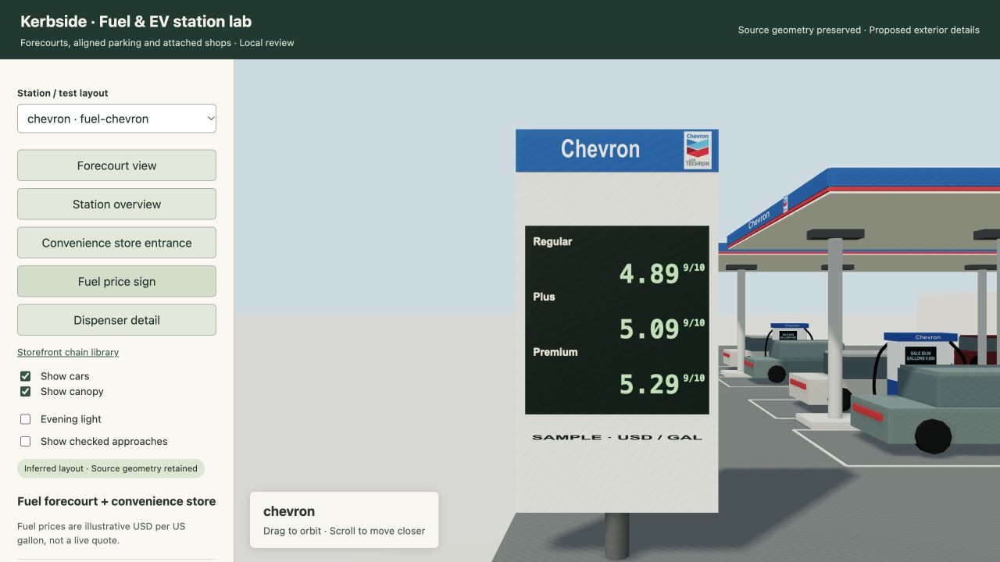
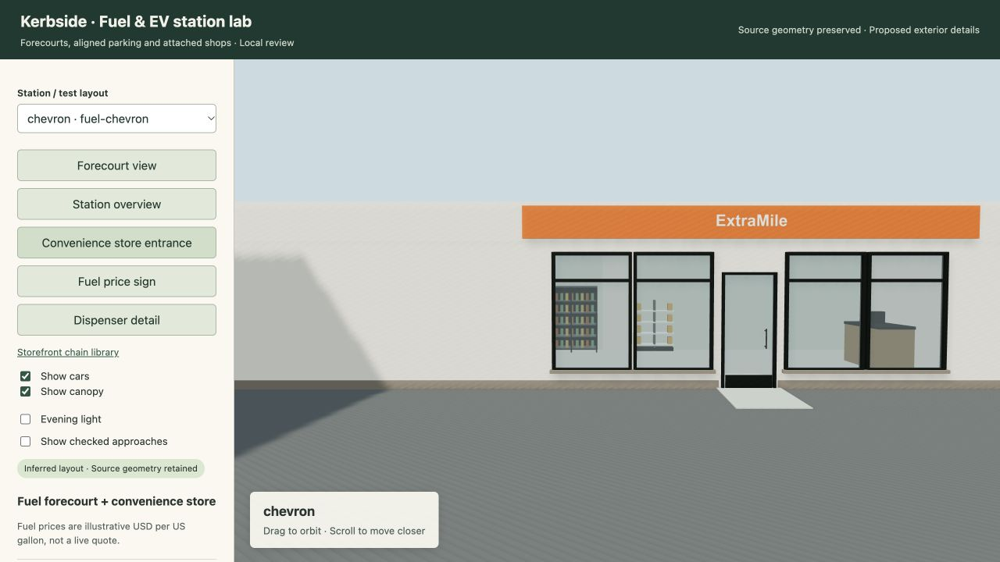

# Visible station identities and entrance-centered signs

Chevron, Shell, ARCO and 76 now display a readable chain identity on every usable canopy face, both dispenser faces and the price pylon. The existing official artwork and distinct color kits remain in use. Tightly framed text replaces the earlier padded lettering that became too small when rendered on a fascia. This strengthens existing identities rather than treating a new chain name as evidence for an exact site replica.

Above-store signs default to the center of the customer entrance. Several customer entrances on one frontage use their complete span's midpoint. A sign shrinks before shifting where the frontage edge is tight. Supplied sign positions, protected architecture, tenant boundaries and window clearances remain fixed. Upper-floor balcony doors and service/emergency doors do not affect customer-sign centering.

**Verification:** 56 focused tests passed. All 20 station programs and 76 storefront programs passed layout validation. Real Three.js checks verified finite, contained station geometry and branding on 71 canopy faces. Browser review covered the gas-station identities and entrance-centered store signs. The original canonical world, deployed viewer and published interior snapshots are unchanged. No deployment or push was performed.

[Local review](http://127.0.0.1:8799/stations.html) · [Structured results](2026-10-30-chain-identity-and-entry-signs.json)

