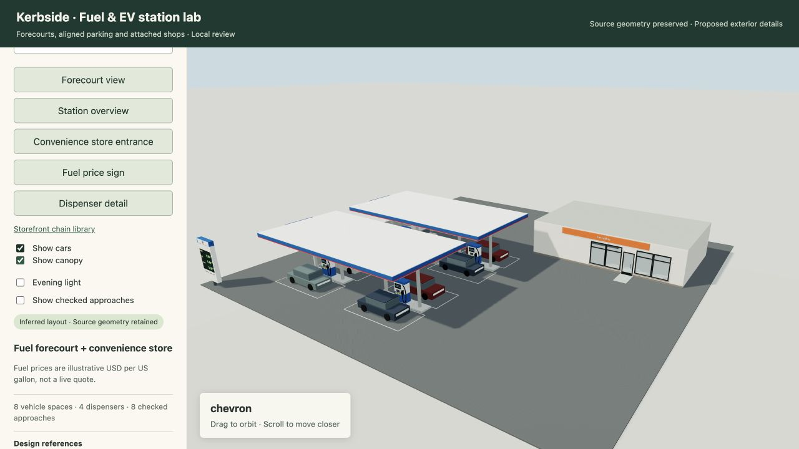
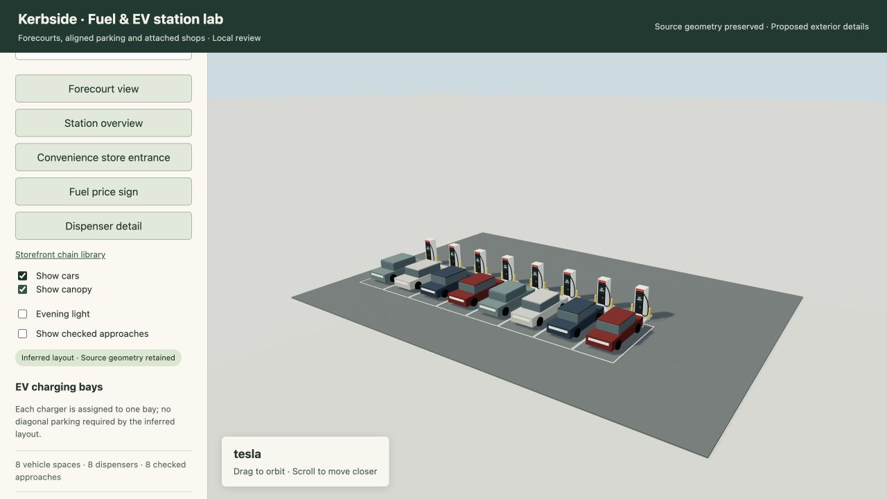
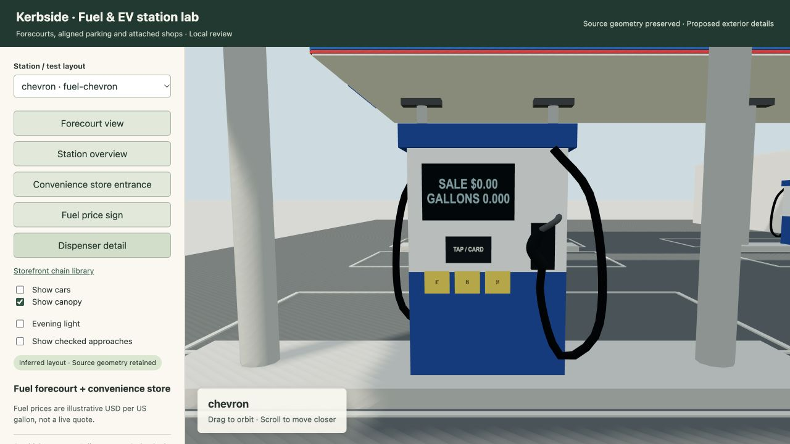
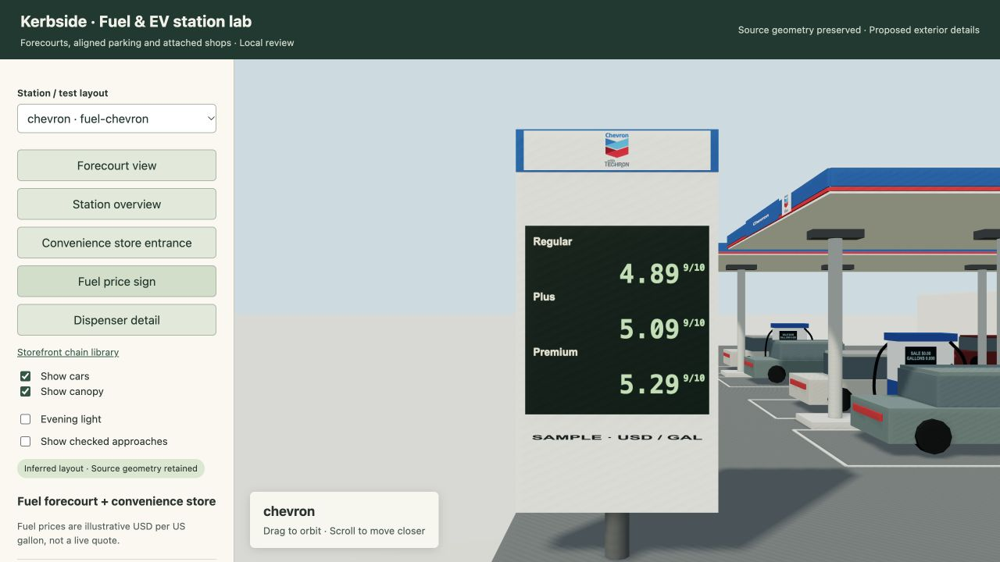
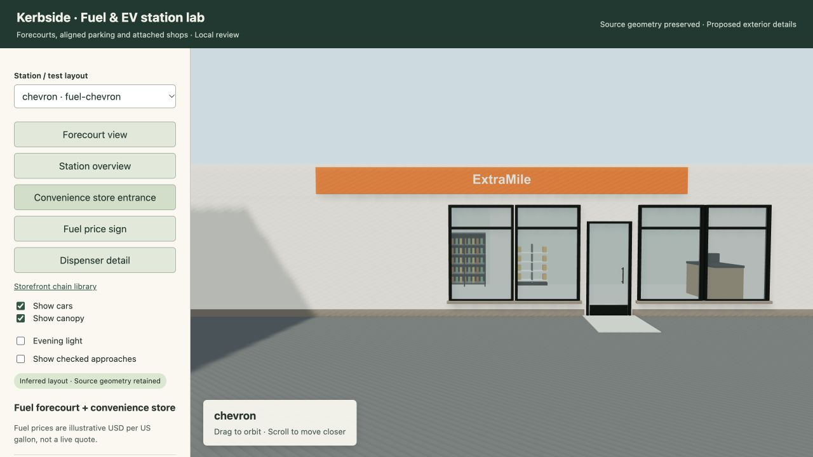
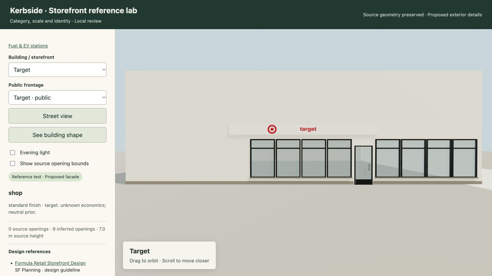

# Fuel and EV station exteriors — 2026-10-30

Implemented lot-driven fuel and EV station inference, a Three.js renderer, attached corner-store furnishing, a local review browser and expanded chain identities. The source world and deployed viewer are unchanged.

## Result

- Opposed dispenser faces, hose loops, holsters/nozzles, payment/display panels and grade buttons face their assigned lanes.
- EV chargers align with their own parallel bays, with wheel stops, bollards, representative cable reach and room for a car at each. Measured stalls retain their positions.
- Source lot shape controls capacity, including concave and rotated lots. Supports stay outside vehicle spaces. Approach corridors are checked with neighboring bays occupied; impossible source layouts reject rather than being silently repaired.
- Attached shops use the existing corner-store engine and the same exterior door/window ledger. Shelves are stocked with snack packages, coolers with beverages, and checkout/staff areas retain the generated layout.
- Fuel pylons have grade rows, explicit USD/US-gallon units and fractional 9/10-cent formatting. Default boards say SAMPLE; supplied prices preserve cash/credit basis and source/date.

Station identities cover Chevron, Shell, ARCO, 76, Tesla, ChargePoint, Electrify America and EVgo. Added storefront families are Target, Costco, McDonald's, In-N-Out, Taco Bell, Best Buy, ExtraMile and ampm. Safeway remains present. The shared database now has **61 references, 21 storefront families, eight station families and 12 official artwork assets**. Remaining lettering and the parametric arches motif are approximate, not archived official artwork.

## Verification

**337 tests passed** in the broad facade/interior regression run. After the final source adapter guard and rendering fixes, the focused exterior/station suite passed **51 tests**. These runs overlap and are not summed.

The review bundle retains all **20 fixed station programs** and **76 storefront programs** (the original 48 synthetic programs, eight added chain programs and the same frozen 20 mapped identities). All passed layout validation and loaded in the real browser with no reported errors or missing artwork. Station cases include compact/concave/rotated sites, an obstacle, measured stalls, measured pump positions, a supplied cash/credit price ledger, two EV rows and a short-cable V3-style test.

Real Three.js r160 checks covered every station: finite mesh attributes, rendered lot bounds retained, 221,406 triangles across all 20 scenes and at most 51 visible meshes per scene including placeholder cars. Static details and vehicles are batched by material. A separate geometry probe checked lettering depth on 31 sign panels; the browser check caught and corrected composite artwork hidden by a fascia or rendered with insufficient contrast.

The complete local flow was checked: builder → JSON/official assets → HTTP responses → WebGL → selection and view controls. Vehicle visibility was also tested across case changes. Python lint/format and JavaScript syntax checks passed. The core map source, canonical world JSON and published interior snapshots have no changes in this pass.

These are geometry/operation checks, not an as-built visual accuracy score. The 20 station programs are synthetic tests. A network name does not establish charger generation, and the existing mapped fuel canopies are not expanded into invented parcels. Full mapped station generation requires a supplied site boundary and any observed parking/entry geometry. No public deployment, push or existing preview restart was performed.

## Review and reproduction

[Local station review](http://127.0.0.1:8799/stations.html) · [Expanded storefront review](http://127.0.0.1:8799/) · [Input contract and build commands](../31-fuel-and-ev-exteriors.md) · [Reference additions](2026-10-30-station-reference-index.md) · [Structured verification](2026-10-30-fuel-and-ev-exteriors.json)

