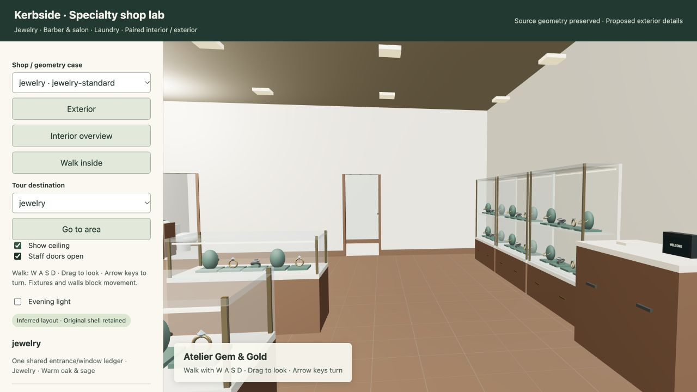
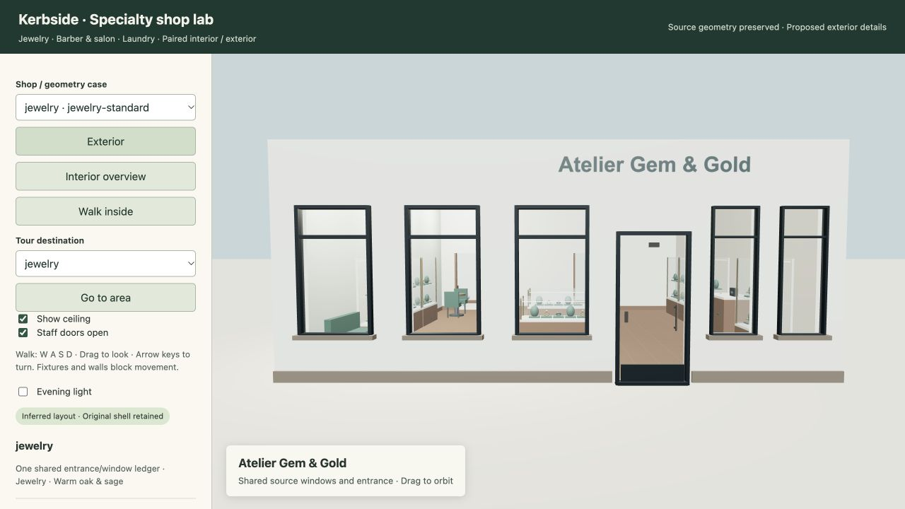
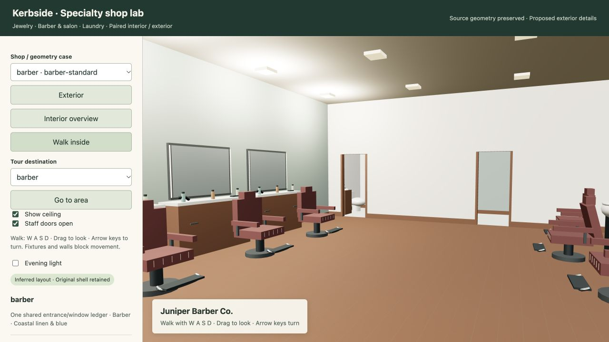
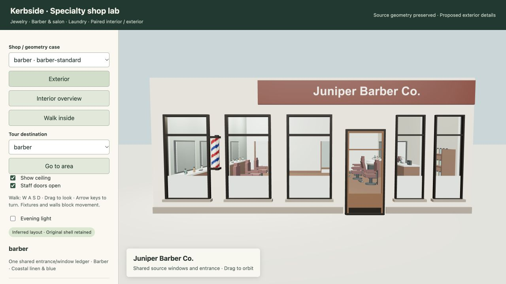
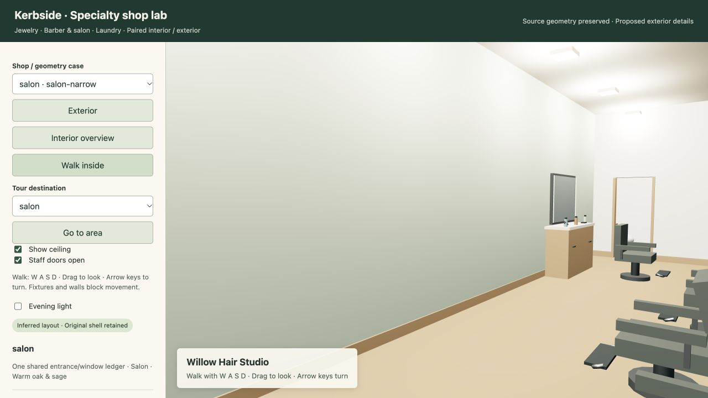
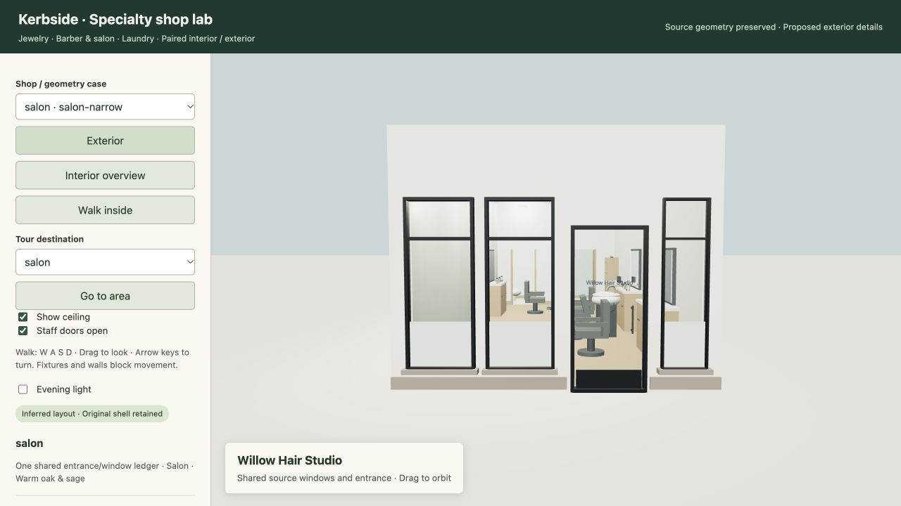
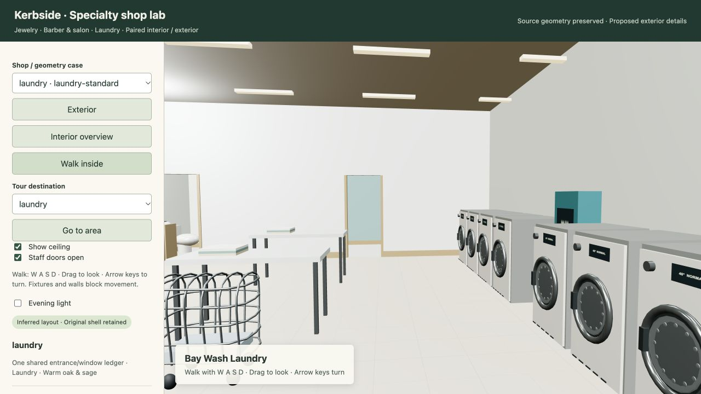
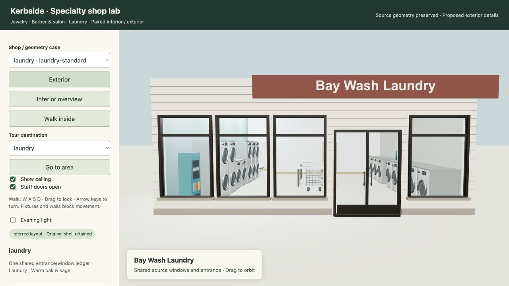
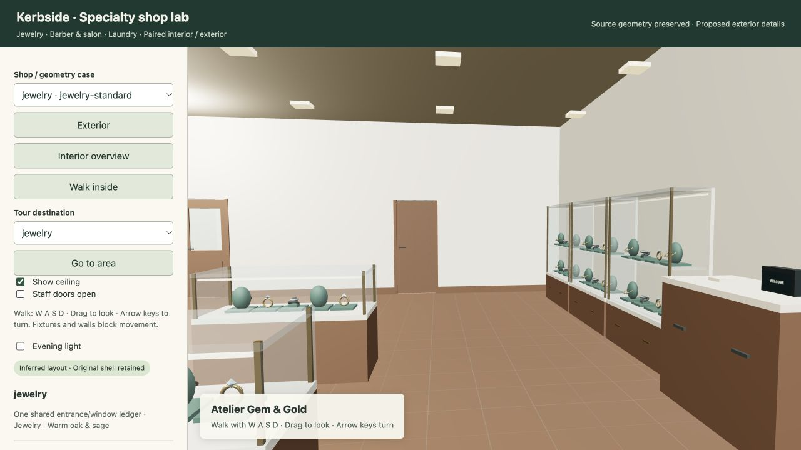

# Specialty shop interiors and exteriors — 2026-10-31

Implemented paired jewelry, barbershop/salon and self-service laundry programs, using
Kerbside's source polygons/heights, shared exterior apertures, existing furnishing solver,
style/catalog infrastructure and walking system. Review is local; no deployment or push.

## Result

- Jewelry stores have glass/brass showcases with supported trays and jewelry forms, consultation furniture, checkout, a safe and staff space. Display-window sills and secure glazed entries differ from hair/laundry frontages.
- Barbers and salons have coordinated station counters/chairs/mirrors, hydraulic bases and footrests, products/tools, waiting/reception and shampoo bowls with taps/hoses. Barber storefronts have timber/glass doors and striped poles when a solid pier fits.
- Laundromats have washers and stacked dryers with drums/controls/handles/vents, usable folding space, towels, carts, payment and detergent kiosks. Glazed double doors support carts where width permits; supplied narrower doors remain authoritative.
- All programs include a connected staff room and furnished toilet. Derived room polygons cover the actual inset footprint without hall stubs. Whole wall finishes extend behind equipment, stop at openings and use coordinated colors, skirting and floor patterns.
- Exterior and interior consume one window/entrance ledger. Supplied observations retain geometry, leaf count, operation and provenance. Signs retain the existing entrance-centered default. Door swings are tested against circulation/fittings, and walking collides with the selected physical leaf in both open and closed poses.

The shared library now has **69 references and 27 categories**. The existing 21 storefront
chain identities, eight station identities and 12 archived logo assets remain available.
Eight vendor/local-merchant references were added; see the [reference index](2026-10-31-specialty-reference-index.md).
Fixture forms are representative procedural geometry, not asserted replicas of vendor products.

## Cohort and limitations

**24/24 fixed synthetic programs passed**: jewelry, barber, salon and laundry, each in
standard, narrow, concave, rotated, corner and observed-opening form. Identities were
retained across fixes. No address-specific solver branches were added.

An additional **12 mapped Kerbside candidates were selected before validation**. Four
passed (three salon, one laundry); eight remain rejected in the [structured ledger](2026-10-31-specialty-shops.json):
three need smaller tenant boundaries, three have coarse service classifications
(cleaners or a specialized salon service), and two cannot fit reachable required stations.
Rejected candidates were not replaced by easier successful locations.

Mapped polygons, local coordinate origins, source height derivations and canonical point
ledgers are retained. Full-ground-floor tenancy is explicitly unverified. These results
are plausibility and geometry checks, **not an as-built accuracy percentage**. This pass
furnishes a ground-floor specialty tenant; upper building shells retain their source height.
Numeric circulation margins are visualization rules, not construction or accessibility certification.
One mirror per active hair-service scene has a live reflection; remaining mirrors use an
environment-lit finish. Vendor references do not establish installed products at a mapped shop.

## Verification

A broad regression run passed **122 tests**, covering specialty/exterior/station/store,
restaurant, house, residential-unit, garage, envelope/tour and apartment/performance paths.
After physical door swing changes, the focused specialty/exterior/station/store suite passed
**77 tests**. The final navigation helper was also rerun through the seven specialty tests;
these overlapping runs are not summed.

The actual Three.js r160 geometry probe passed all **28 accepted scenes** with finite
attributes, **1,291,732 triangles in total** and at most **49 batched meshes per scene**
(excluding the optional live mirror). It checked **130 aperture centers** against interior
finish triangles so paint cannot silently fill a shared door/window. Vertex-color
retention is checked so barber poles keep their stripes through batching.

A separate probe runs the actual `TourWorld` collision rules with physical assembly
parts and selected open-door segments. From the public entry it reaches all three rooms
and fixture work targets in all 28 scenes; room spawns are clear, walls block movement,
and closed staff doors block their thresholds.

The complete local flow passed: builder → JSON/artwork → HTTP 200 responses → WebGL →
case selection, public walking and staff/toilet destinations. All **28 scenes and 84 tour
destinations** loaded in the browser without reported errors or warnings. Exterior,
overview, night, ceiling and door controls were checked. Browser review caught and fixed
lost pole vertex colors, unhelpful area viewpoints and open-door collision omissions.
Python lint/format and module syntax checks passed. `graphify update .` refreshed the AST graph.

The core map renderer, canonical world JSON and earlier published interior snapshots
have no changes. Unrelated working-tree files were preserved. No public deploy, push or
restart of an earlier preview was performed.

## Review

[Local 3D review](http://127.0.0.1:8800/specialty.html) ·
[Input contract and reproduction](../32-specialty-shop-interiors-and-exteriors.md) ·
[Structured verification and rejected identities](2026-10-31-specialty-shops.json)

